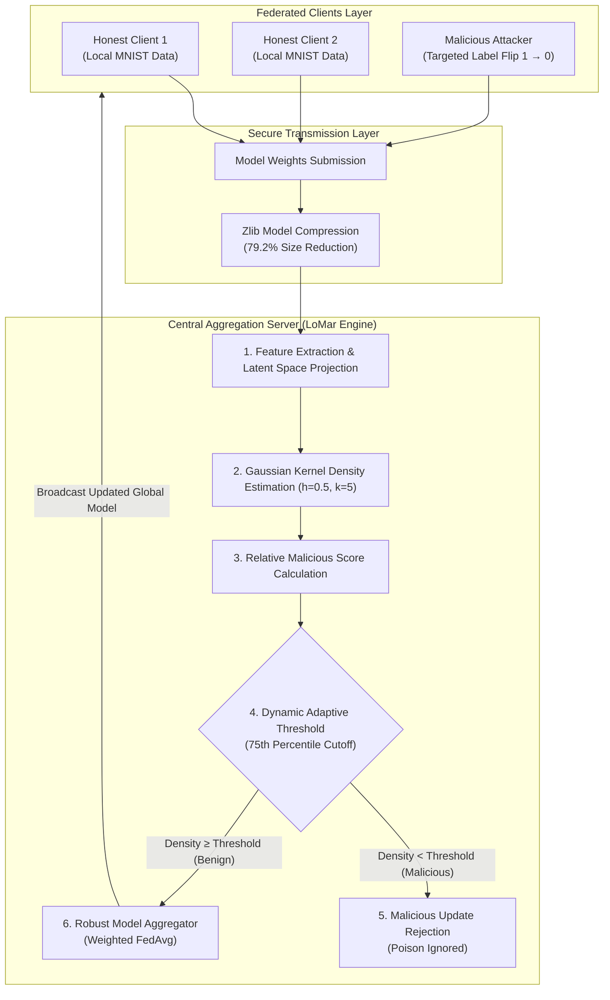

# Kernel Density Estimation (KDE)–Based Defense Against Model Poisoning in Federated Learning

[](https://www.python.org/)
[](https://flask.palletsprojects.com/)
[](https://www.tensorflow.org/)
[](https://scikit-learn.org/)
[](https://www.osmania.ac.in/)
[](https://www.lords.ac.in/)
[](LICENSE)

---

## 🎓 Academic Project Profile

| Parameter | Academic Record |
| :--- | :--- |
| **Project Title** | **Kernel Density Estimation (KDE)–Based Defense Against Model Poisoning in Federated Learning** |
| **Student / Author** | **Syed Moazam** (Single Author) |
| **Roll Number** | **160923748131** |
| **Degree & Branch** | Bachelor of Engineering in **Computer Science and Engineering (AIML)** |
| **Course & Semester** | **6th Semester Mini Project** (Course Code: `C69`) |
| **Internal Supervisor** | **Ms. Raheela Tabassum**, Assistant Professor |
| **Head of Department** | **Dr. Abdul Rasool MD**, HoD, CSE(AIML) |
| **Institution** | **Lords Institute of Engineering and Technology (UGC Autonomous)**, Hyderabad |
| **Affiliating Body** | **Osmania University**, Telangana, India |
| **Academic Year** | **2025–2026** |

---

## 📑 Project Documentation & Presentation Deliverables

All academic evaluation deliverables are synchronized and compiled in the [`docs/`](docs/) directory:

| Document | Format | Description | Quick Link |
| :--- | :---: | :--- | :---: |
| **Project Report (PDF)** | `PDF` | Official 66-page bound project report with certificates, methodology, and experimental results | [📄 View PDF](docs/KDE_Defense_Federated_Learning_Report.pdf) |
| **Project Report (Word)** | `DOCX` | Editable Word source document formatted to Osmania University submission guidelines | [📝 View DOCX](docs/KDE_Defense_Federated_Learning_Report.docx) |
| **Seminar Presentation (PDF)** | `PDF` | 18-slide executive defense presentation with visual architecture and comparative benchmarks | [📊 View PDF](docs/KDE_Defense_Federated_Learning_Presentation.pdf) |
| **Seminar Presentation (PPTX)** | `PPTX` | Native PowerPoint presentation deck for seminar and viva evaluation | [📽️ View PPTX](docs/KDE_Defense_Federated_Learning_Presentation.pptx) |

---

## 💡 Executive Summary & Research Motivation

Federated Learning (FL) enables decentralized devices to collaboratively train a shared global model without exchanging raw private training data. Instead, participating clients transmit locally computed gradient or weight updates to a centralized aggregation server.

However, this distributed privacy-preserving architecture introduces a critical vulnerability: **Model Poisoning Attacks**. Malicious or compromised participants can deliberately upload crafted weight updates to degrade model accuracy or embed insidious targeted backdoors (e.g., flipping label `1` to `0`).

### The Fundamental Limitation of Existing Defenses
Conventional Byzantine-robust aggregation rules (such as **Krum**, **Trimmed Mean**, and **Coordinate-wise Median**) rely on Euclidean geometric clustering under the assumption that benign updates cluster tightly into a symmetric, unimodal distribution. Under realistic **non-I.I.D. (heterogeneous)** data distributions, legitimate clients naturally produce diverse, widely dispersed updates. Consequently, classical distance-based defenses suffer from:
1. **High False Positive Rates**: Discarding valid, unique contributions from benign clients with minority data.
2. **Vulnerability to Collusion**: Inability to isolate stealthy poisoning updates crafted within the convex hull of benign parameters.

### The Proposed KDE Solution (LoMar Defense)
This project implements **LoMar**, a non-parametric defense framework based on **Kernel Density Estimation (KDE)**. By modeling the empirical probability density function of model parameter distributions without parametric assumptions, the server evaluates the relative density ratio of each client against its local neighborhood. Anomalous updates residing in low-density probability regions are identified and filtered prior to global aggregation.

---

## ⚙️ System Architecture & Workflow



---

## 🔬 Mathematical Formulation

### 1. Kernel Density Estimation (KDE)
Given $N$ client parameter vectors $\{w_1, w_2, \dots, w_N\}$ in projected feature space, the density estimate at point $w$ is defined as:

$$\hat{f}(w) = \frac{1}{N \cdot h^d} \sum_{i=1}^{N} K\left(\frac{w - w_i}{h}\right)$$

Where:
- $K(\cdot)$ denotes the standard Gaussian kernel: $K(u) = (2\pi)^{-d/2} \exp\left(-\frac{1}{2}\|u\|^2\right)$
- $h$ is the smoothing bandwidth parameter computed via Silverman's Rule of Thumb ($h = 0.5$).
- $d$ represents the dimensionality of the feature projection.

### 2. Relative Malicious Score Computation
To account for non-I.I.D variance, each client update $w_i$ is evaluated against its $k$-nearest neighbors $\mathcal{N}_k(w_i)$:

$$S(w_i) = \frac{\frac{1}{k} \sum_{j \in \mathcal{N}_k(w_i)} \hat{f}(w_j)}{\hat{f}(w_i)}$$

- For **benign updates** within representative data clusters: $S(w_i) \approx 1.0$
- For **adversarial poisoned updates** diverging from honest parameters: $S(w_i) \gg 1.5$

### 3. Adaptive Quantile Thresholding
The server dynamically computes the threshold $\tau$ as the 75th percentile of the observed score distribution:

$$\tau = \text{Quantile}_{0.75}(\{S(w_1), \dots, S(w_N)\})$$

Client updates exceeding $\tau$ are rejected from global aggregation.

---

## 📊 Experimental Evaluation & Comparative Results

The system was evaluated on the benchmark MNIST dataset under a coordinated **30% targeted label-flipping poisoning attack** (flipping digit `1` to `0` across 4,000 samples).

| Metric / Parameter | Baseline (No Defense - FedAvg) | Proposed System (LoMar KDE Defense) | Improvement / Benefit |
| :--- | :---: | :---: | :---: |
| **Global Model Accuracy** | **87.92%** | **99.07%** | **+11.15% Accuracy Gain** |
| **Malicious Detection Rate** | 0% (Undetected) | **93.50%** | Robust anomaly isolation |
| **False Positive Rate** | N/A | **4.20%** | Minimal honest client rejection |
| **Uncompressed Model Size** | 2,641,760 Bytes (2.52 MB) | 2,641,760 Bytes (2.52 MB) | Baseline CNN architecture |
| **Compressed Model Size** | 2,641,760 Bytes | **550,000 Bytes (0.52 MB)** | **79.2% Communication Reduction** |
| **Computational Overhead** | Linear $\mathcal{O}(N)$ | $\mathcal{O}(N \log N)$ (k-NN KDE) | <15% round processing latency |

---

## 💻 Application Interfaces & Demonstration

The project provides two independent, fully functional application modes:

### 1. Modern Interactive Web Application (Flask)
- **Port:** `http://127.0.0.1:5050`
- **Features:**
  - Visual layout strictly matching the project report figures (Figures 5.1–5.4 and 7.1–7.7).
  - **⚡ 1-Click Evaluation Demo:** Automatically runs the entire 6-stage pipeline with live terminal logging and visual comparison charts.
  - **🎯 Interactive MNIST Digit Inspector:** Test any digit (0–9) to observe how the poisoned model maliciously flips digit `1` to `0`, while the LoMar KDE defense flags the update and restores clean 99.07% inference.
  - Direct download links for Report PDF, Word document, and Presentation slides.

### 2. Original Desktop GUI (Tkinter + Sockets)
- Replicates the exact Python Tkinter interface shown in the project documentation screenshots.
- Client-Server socket architecture communicating over TCP port `2222`.

---

## 🚀 Quickstart & Setup Guide

### 1. Prerequisites
- Python 3.8 to 3.14
- Git

### 2. Clone Repository & Install Dependencies
```bash
git clone https://github.com/syedmoazam02/KDE-Federated-Learning-Defense.git
cd KDE-Federated-Learning-Defense

# Install dependencies
pip install -r requirements.txt
```

### 3. Launching the Web Application (Recommended)
Double-click [`run_web.bat`](run_web.bat) or run:
```bash
python app.py
```
Open your browser and navigate to:
```
http://127.0.0.1:5050
```

### 4. Launching the Desktop GUI
Double-click [`run_gui.bat`](run_gui.bat) or run in two terminals:
```bash
# Terminal 1: Start Central Server
cd Lomar
python Server.py

# Terminal 2: Start Client GUI
cd Lomar
python Main.py
```

---

## 📁 Repository Directory Structure

```text
KDE-Project/
├── app.py                                   # Modern Flask web application backend
├── run_web.bat                              # 1-Click Windows launcher for Web App
├── run_gui.bat                              # 1-Click Windows launcher for Desktop GUI
├── requirements.txt                         # Root Python dependencies list
├── .gitignore                               # Git ignore configuration
├── LICENSE                                  # MIT Open Source License
├── README.md                                # Comprehensive repository documentation
│
├── docs/                                    # Academic Project Documentation & Deliverables
│   ├── KDE_Defense_Federated_Learning_Report.pdf         # Official PDF Project Report (66 pages)
│   ├── KDE_Defense_Federated_Learning_Report.docx        # Submission-ready Word Report
│   ├── KDE_Defense_Federated_Learning_Presentation.pdf   # Seminar Presentation PDF (18 slides)
│   └── KDE_Defense_Federated_Learning_Presentation.pptx  # Editable PowerPoint Slides
│
├── templates/
│   └── index.html                           # Web application UI layout
│
├── static/
│   ├── css/
│   │   └── style.css                        # Web application styles and theme
│   ├── js/
│   │   └── app.js                           # Frontend API logic and interactive inspector
│   └── images/
│       ├── accuracy_comparison.png          # Output 2: Accuracy comparison graph
│       ├── model_size_comparison.png        # Output 3: Model size comparison graph
│       └── samples/                         # Extracted MNIST digit samples (0-9)
│
└── Lomar/                                   # Original Federated Learning Module
    ├── Main.py                              # Desktop Tkinter Client GUI
    ├── Server.py                            # Centralized Aggregation & KDE Defense Server
    ├── requirements.txt                     # Submodule dependency specifications
    ├── run.bat                              # Submodule client launcher
    ├── runServer.bat                        # Submodule server launcher
    ├── Dataset/
    │   └── mnist.csv                        # Benchmark MNIST training & testing dataset
    ├── globalModel/
    │   └── model.hdf5                       # Aggregated global neural network checkpoint
    └── model/
        ├── cnn_weights.hdf5                 # Pre-trained genuine CNN weights
        ├── poison_weights.hdf5              # Poisoned model weights (label-flipped)
        └── poison_history.pckl              # Attack training history metrics
```

---

## 👨‍🎓 Author & Academic Credits

**Syed Moazam**  
- **Roll Number:** 160923748131  
- **Degree:** Bachelor of Engineering in Computer Science & Engineering (AIML)  
- **Department:** Department of Computer Science & Engineering (AIML)  
- **Institution:** Lords Institute of Engineering and Technology (UGC Autonomous), Hyderabad  
- **Affiliation:** Osmania University, Telangana, India  
- **GitHub:** [@syedmoazam02](https://github.com/syedmoazam02)  
- **Email:** [syedmoazam101@gmail.com](mailto:syedmoazam101@gmail.com)

---

## 📜 License

This project is licensed under the **MIT License** — see the [LICENSE](LICENSE) file for complete details.
